<p align="center">
  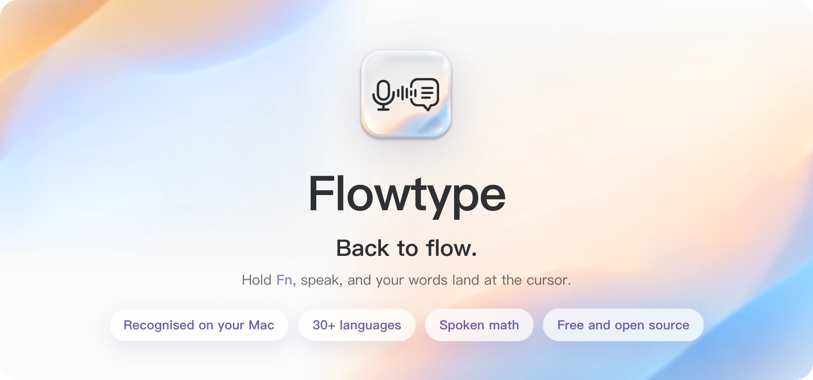
</p>

<p align="center">
  English · <a href="README.md">简体中文</a>
</p>

<p align="center">
<a href="https://github.com/smgonthebeat/Flowtype/releases/download/v0.1.0-preview.8/Flowtype.dmg">
  
</a>
</p>

<p align="center">
  <a href="https://github.com/smgonthebeat/Flowtype/releases/tag/v0.1.0-preview.8"><code>v0.1.0-preview.8</code></a> ·
  <a href="https://github.com/smgonthebeat/Flowtype/releases/download/v0.1.0-preview.8/Flowtype.dmg.sha256">Verify SHA-256</a> ·
  <a href="#first-launch">First-launch guide</a>
</p>

> [!NOTE]
> This is a Preview. The DMG uses an ad-hoc local development signature: it is **not signed with an Apple Developer ID and not notarized by Apple**. macOS blocks the first launch until you choose Open Anyway in System Settings → Privacy & Security; see the [first-launch guide](#first-launch).

Flowtype is a local-first macOS dictation app. Hold `Fn` and speak; release it, and Flowtype transcribes on this Mac and places the whole sentence at the cursor of the app you were using. It is built for the way people actually talk: Chinese mixed with English, plenty of technical terms, and even formulas read aloud.

<!-- LAUNCH VIDEO: replace the placeholder below with the Flowtype Dawn launch video when it is ready. -->
<p align="center">
  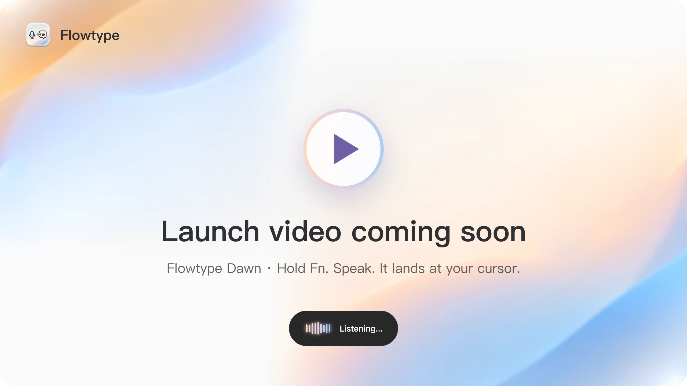
</p>

## How it works

<p align="center">
  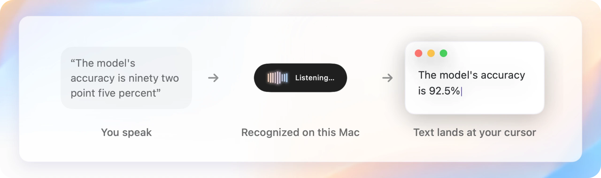
</p>

1. Put the cursor where you want to type, in any app.
2. Hold `Fn` and speak. The recording capsule appears at the bottom of the screen, its Dawn waveform following your voice.
3. Release `Fn`. Flowtype transcribes on your Mac and the whole sentence lands at the cursor in one go.

No window switching, no copy and paste.

## Faster than typing

<p align="center">
  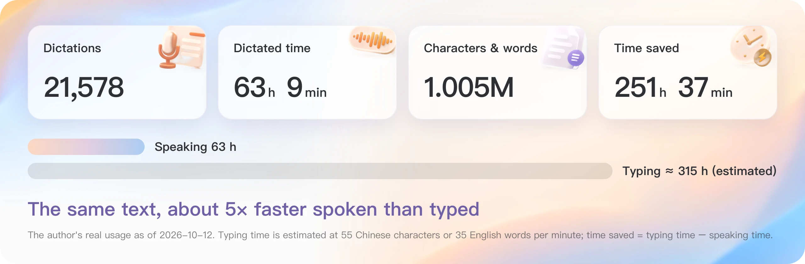
</p>

These are the author's own everyday numbers as of 2026-10-12: **21,578 dictations**, **63 h 9 min** of speech, **1.005 million** characters and words. Typing the same text would take an estimated 315 hours, so Flowtype saved about **251 h 37 min**. Flowtype was a tool its author used every day before it became an open-source project.

<sub>Typing time is estimated at 55 Chinese characters or 35 English words per minute, minus the speaking time. Chinese is counted by character, English by word.</sub>

## Chinese and English in one breath, technical terms included

Real speech is rarely one language at a time. For example:

> 帮我看一下这个 SwiftUI view，为什么 onAppear 会触发两次？

Flowtype recognises mixed Chinese and English with Qwen3-ASR running on your Mac. Add the product names, people and terms you use to the **Dictionary**; those hotwords are passed to the local model as context, so names and capitalisation come out right the first time more often.

<p align="center">
  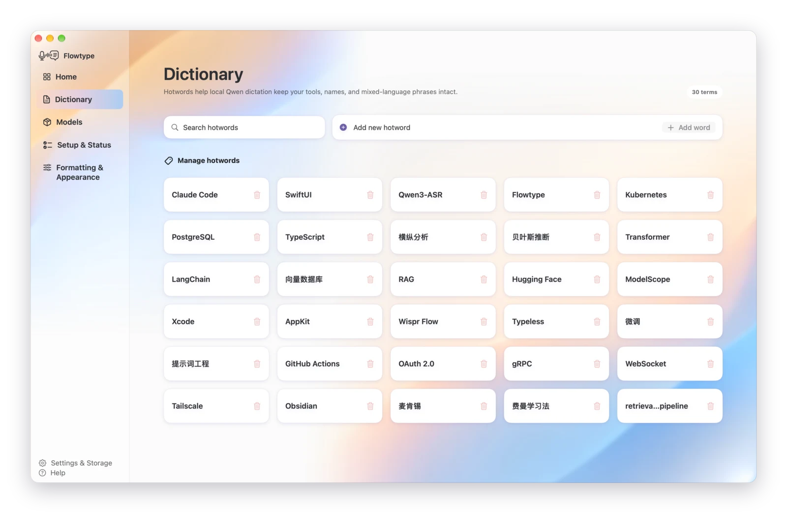
</p>

## Say it. Get the formula.

Turn on spoken math and read formulas aloud; Flowtype turns them into real mathematical notation on your Mac. Choose **Unicode** (plain text symbols that work anywhere) or **LaTeX** (for Markdown, Obsidian and papers).

<p align="center">
  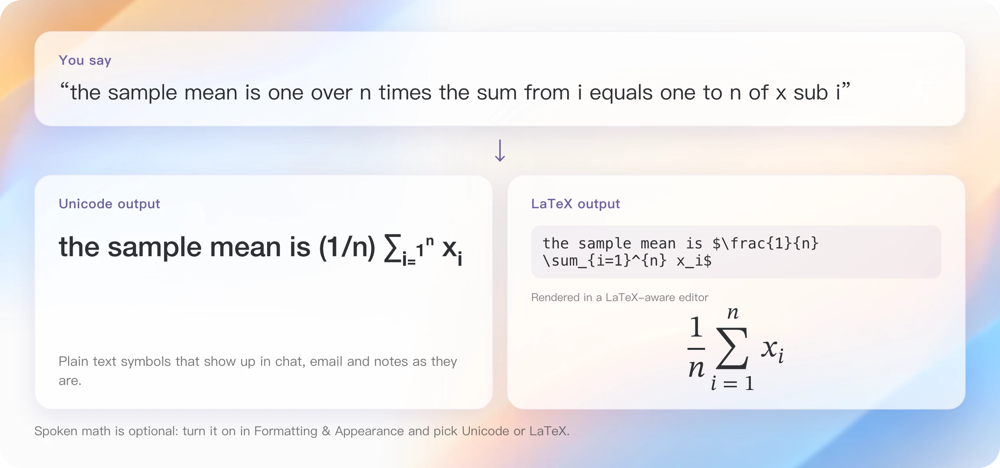
</p>

More examples:

| You say | Unicode output | LaTeX output (rendered) |
|---|---|---|
| the regression model is y equals beta zero plus beta one x plus epsilon | the regression model is y = β₀ + β₁x + ε | the regression model is $y = \beta_0 + \beta_1 x + \epsilon$ |
| x follows a normal distribution with mean mu and variance sigma squared | X ∼ N(μ, σ²) | $X \sim N(\mu, \sigma^2)$ |
| the confidence interval is x bar plus or minus z sub alpha over two times sigma over root n | the confidence interval is x̄ ± z_{α/2}·σ/√n | the confidence interval is $\bar{x} \pm z_{\alpha/2} \cdot \frac{\sigma}{\sqrt{n}}$ |
| so theta hat is an unbiased estimator of theta | so θ̂ is an unbiased estimator of θ | so $\hat{\theta}$ is an unbiased estimator of $\theta$ |
| the variance of beta one hat equals sigma squared over n | Var(β̂₁) = σ²/n | $\mathrm{Var}(\hat{\beta}_1) = \frac{\sigma^2}{n}$ |
| probability of A given B equals probability of B given A times probability of A over probability of B | P(A \| B) = P(B \| A)·P(A)/P(B) | $P(A \mid B) = P(B \mid A) \cdot \frac{P(A)}{P(B)}$ |
| the sum from k equals one to infinity of one over k squared equals pi squared over six | ∑_{k=1}^{∞} 1/k² = π²/6 | $\sum_{k=1}^{\infty} \frac{1}{k^2} = \frac{\pi^2}{6}$ |
| integral from negative infinity to infinity of e to the minus x squared dx equals root pi | ∫_{−∞}^{∞} e^{−x²} dx = √π | $\int_{-\infty}^{\infty} e^{-x^2}\\,dx = \sqrt{\pi}$ |
| 面积就是 integral from zero to one of f of x dx | 面积就是 ∫₀¹ f(x) dx | 面积就是 $\int_{0}^{1} f(x)\\,dx$ |

<sub>Every output above was produced by Flowtype's local converter, assuming speech recognition heard the sentence correctly. Spoken math is optional and off by default; turn it on in Formatting & Appearance.</sub>

## Recognised on your Mac

Flowtype does not rely on an “upload, then delete” promise for routine dictation. It keeps that path out of cloud ASR processing in the first place:

- **Local transcription:** Qwen3-ASR runs on Apple Silicon through a session-token-protected helper bound only to `127.0.0.1`. Once the model is installed, routine dictation does not upload the recording.
- **Temporary local audio, deleted after transcription:** each dictation's temporary WAV is removed when the transcription task ends. With History enabled, only the three most recent recordings are kept locally for manual retry, and clearing History clears them too.
- **History under your control:** transcript text is stored only in Flowtype History on this Mac, 100 entries by default; you can turn it off, resize it or clear it.
- **On-device fallback:** Apple Speech runs only when on-device recognition is supported and sets `requiresOnDeviceRecognition`.
- **Explicit network boundary:** first-time setup downloads a model of about 1.9 GB. That is an explicit network step; routine transcription stays on the Mac.

<p align="center">
  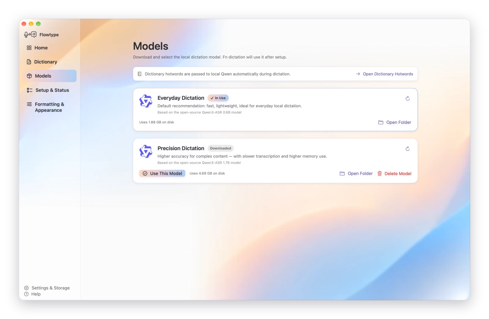
</p>

Mainstream dictation products including Wispr Flow, Typeless, Qianwen IME, and Doubao IME send audio to cloud services in some or all reviewed transcription paths. Some provide encryption, immediate deletion, Privacy Mode, or zero-retention controls; those are meaningful privacy measures. Flowtype's distinction is avoiding the routine transcription upload, not alleging that another product uploads every keystroke. Local-capable products such as Shandianshuo are not cloud-only comparisons.

See [Privacy & Local Data](docs/PRIVACY.md) for Flowtype's boundaries and [Local And Cloud Dictation Comparison](docs/PRIVACY-COMPARISON.md) for the dated, versioned evidence notes.

## And also

- **Smart formatting:** numbers, percentages, dates and question parts are tidied, for example "three point five percent" → `3.5%`; optionally remove fillers such as "um" and "uh".
- **Flowtype Dawn:** the default light theme; other themes are one click away.
- **Chinese or English interface:** pick the interface language on first launch and the menus, main window and Settings follow; reading text comes in three sizes.
- **Recoverable failures:** History, up to three local retry recordings, model status and diagnostics help you recover text and find the cause.
- **Guided start:** a five-page illustrated onboarding with a page for practising `Fn`.

<p align="center">
  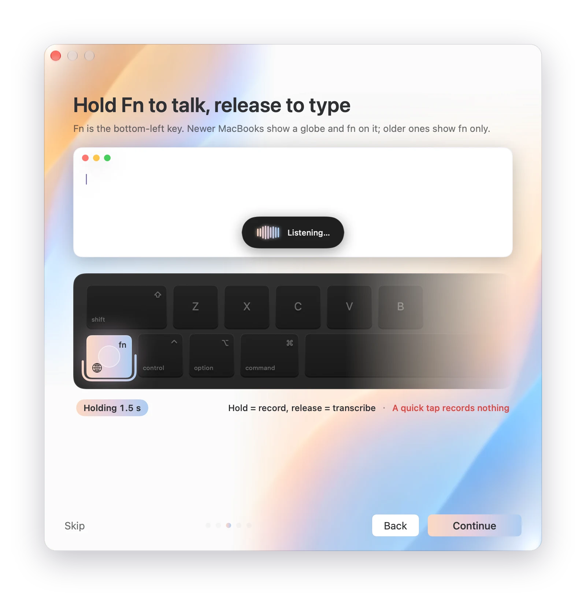
</p>

<sub>Practising <code>Fn</code> in onboarding. History, hotwords and statistics in the interface screenshots are demo data.</sub>

## Install

### Requirements

- macOS 14 or later on an Apple Silicon Mac;
- Microphone and Accessibility permissions;
- several gigabytes of free storage and unified memory for the local model and runtime.

### Download and setup

Download `Flowtype.dmg` only from the official [`v0.1.0-preview.8` Release](https://github.com/smgonthebeat/Flowtype/releases/tag/v0.1.0-preview.8), open it, and follow the arrow to drag `Flowtype.app` to Applications. You do not need Swift or a source checkout.

On first launch, a five-page illustrated guide walks you through choosing the interface language, preparing Flowtype and practising holding `Fn` to talk. Clicking **Prepare Flowtype** confirms the download: Flowtype requests Microphone and Accessibility permissions, downloads the approximately 1.9 GB default Qwen3-ASR 0.6B model, and shows downloaded bytes, smoothed transfer speed, estimated time remaining and preparation progress. Fresh downloads prefer ModelScope, with resumable transfer and a Hugging Face fallback. Accessibility must still be approved in System Settings; return to Flowtype and setup continues automatically. Once preparation succeeds, Home immediately reuses the verified Ready state without asking you to prepare Flowtype again. Model weights are not stored in this repository or bundled with the source archive.

<a id="first-launch"></a>

### Open Flowtype for the first time

This is an explicitly labelled **unnotarized Preview**. macOS will block the first double-click because it cannot verify the developer. That is expected for the current signature and does not mean you should disable macOS security protections. The screenshots use a Chinese macOS interface; the control locations are the same in other system languages.

<table>
  <tr>
    <td width="42%" valign="top">
      <strong>1. Try to open Flowtype once</strong><br><br>
      Double-click Flowtype in Applications and choose Open in the warning. If macOS still blocks the launch, dismiss the dialog and continue to the next step. The Open Anyway control appears only after this first attempt.
    </td>
    <td width="58%" valign="top">
      <strong>2. Allow it in Privacy &amp; Security</strong><br><br>
      Open System Settings → Privacy &amp; Security, scroll to Security, find the message that Flowtype was blocked, and choose Open Anyway. Authenticate if prompted, then confirm Open.
    </td>
  </tr>
  <tr>
    <td valign="top">
      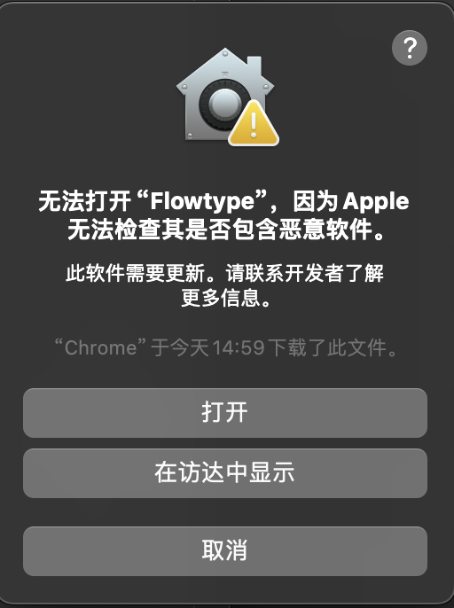
    </td>
    <td valign="top">
      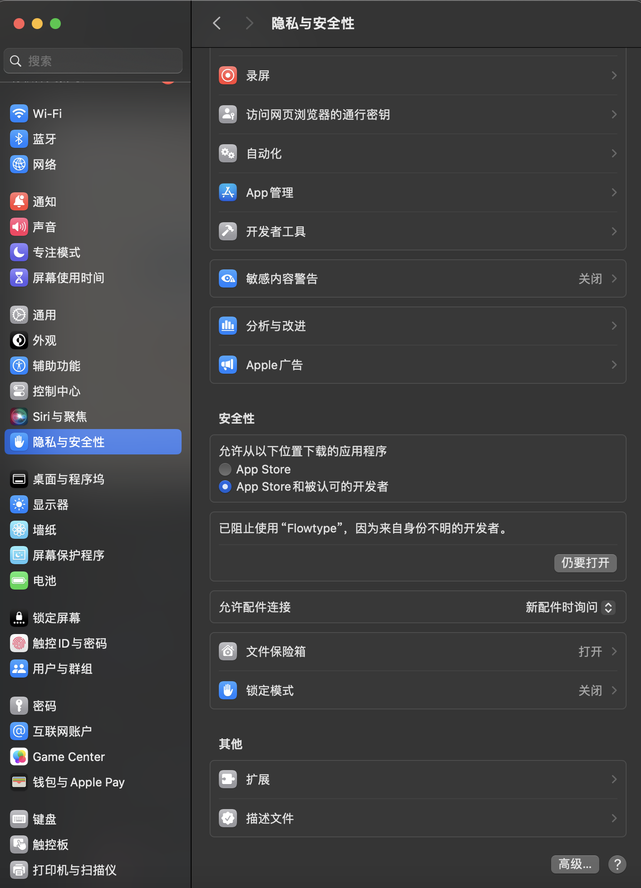
    </td>
  </tr>
</table>

**3. Compare with Apple's official steps.** Apple's current instructions likewise require an initial launch attempt followed by System Settings → Privacy & Security → Security → Open/Open Anyway. The control is generally available for about one hour after the attempt. If it is missing, double-click Flowtype again and return to the settings page immediately.

<details>
<summary>Show Apple's official guide</summary>

<a href="https://support.apple.com/guide/mac-help/open-a-mac-app-from-an-unknown-developer-mh40616/mac">
  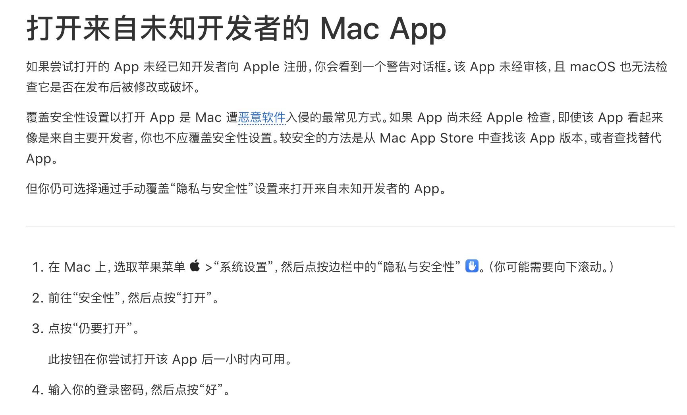
</a>

*[View Apple's live official instructions](https://support.apple.com/guide/mac-help/open-a-mac-app-from-an-unknown-developer-mh40616/mac). The screenshot is a location aid; Apple may change the page or macOS wording over time.*

</details>

Use this override only for Flowtype obtained from this project's official Release. **Do not disable Gatekeeper or run quarantine-removal or Gatekeeper-disabling commands.**

## Build from source

These commands are for developers who want to inspect or modify the source, and need Swift 5.9 or later:

```bash
swift test
uv run --project Helpers/qwen-asr-helper --frozen pytest
make build
```

`make build` creates a locally ad-hoc-signed development bundle at `.build/Flowtype.app`; it is not an official distribution build.

## Documentation

- [Installation & Source Builds](docs/INSTALL.md)
- [Privacy & Local Data](docs/PRIVACY.md)
- [Local And Cloud Dictation Comparison](docs/PRIVACY-COMPARISON.md)
- [Architecture](docs/ARCHITECTURE.md)
- [Troubleshooting](docs/TROUBLESHOOTING.md)
- [Changelog](CHANGELOG.md)
- [Contributing](CONTRIBUTING.md)
- [Security Policy](SECURITY.md)

The static product website lives in [`website/`](website/). It has no build step, analytics, cookies, external scripts or runtime package dependencies; its GitHub and DMG links point to the official repository and Preview Release. Never attach real recordings, transcripts, credentials or private diagnostics to an issue.

## License

Flowtype software and project-provided assets are licensed under [`GPL-3.0-only`](LICENSE) to the extent the project can grant those rights. Exceptions for third-party components, assets, and marks are documented in [THIRD_PARTY_NOTICES.md](THIRD_PARTY_NOTICES.md), [ASSET_PROVENANCE.md](ASSET_PROVENANCE.md), and [TRADEMARKS.md](TRADEMARKS.md).
