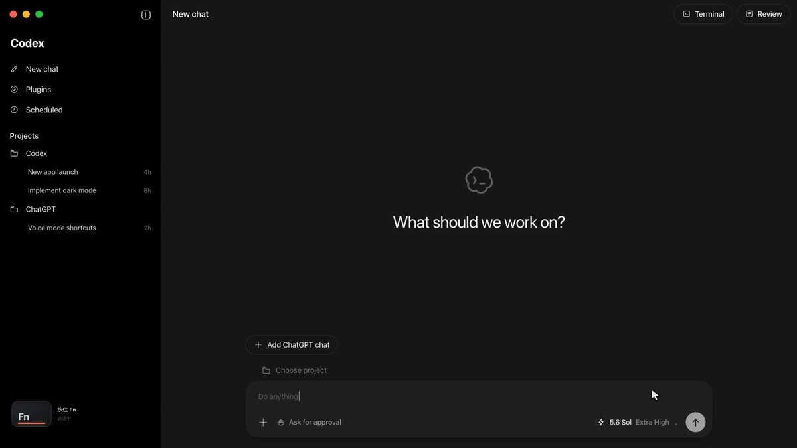
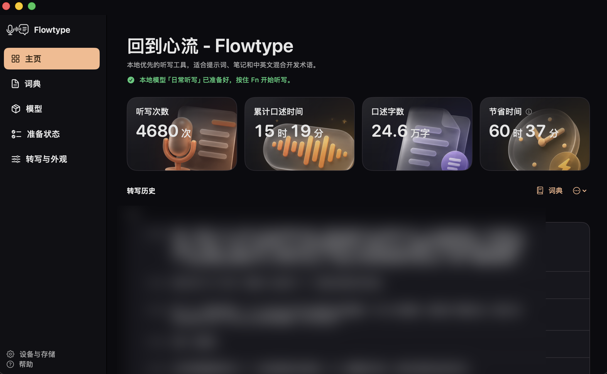

<p align="center">
  
</p>

# Flowtype

[English](README.en.md) · 简体中文

> **Release status:** [`v0.1.0-preview.7`](https://github.com/smgonthebeat/Flowtype/releases/tag/v0.1.0-preview.7) Apple Silicon DMG 已开放下载。它使用 local development signature，**没有 Apple Developer ID，也未经过 Apple notarization**；macOS 会拦截首次启动，需要用户在 System Settings → Privacy & Security 中明确选择 Open Anyway。
>
> [首次打开指引 ↓](#first-launch)

<a href="https://github.com/smgonthebeat/Flowtype/releases/download/v0.1.0-preview.7/Flowtype.dmg">
  
</a>

[校验 SHA-256](https://github.com/smgonthebeat/Flowtype/releases/download/v0.1.0-preview.7/Flowtype.dmg.sha256) · [查看 Release](https://github.com/smgonthebeat/Flowtype/releases/tag/v0.1.0-preview.7) · [GitHub Repository](https://github.com/smgonthebeat/Flowtype)

Flowtype 是一款 local-first macOS 听写工具。按住 `Fn` 说话，松开后完成本地转写，并把结果粘贴到刚才使用的 App 中。它重点处理中文、English、technical terms 与 spoken mathematics 混合出现的真实口述场景。

### 完整产品演示（37 秒）


这段 37 秒演示展示 `Fn` 听写流程与 Flowtype 的主要页面。画面为隐私安全的产品演示，不包含真实转写历史、录音或账户信息；片头素材由作者确认拥有或有权公开使用。

### 快速工作流演示（10 秒）



这段合成演示用 Codex `New chat` 说明普通文本粘贴流程，不包含真实对话、录音或账户信息，也不代表 Flowtype 与 OpenAI 存在集成、合作、赞助或背书关系。



这不是 mock data。作者明确选择公开这张 2026-07-23 的真实使用截图：Flowtype 已完成 **4,680 次听写**、累计 **15 小时 19 分钟**口述、转写 **24.6 万字**，估算节省 **60 小时 37 分钟**。为保护隐私，下方转写历史已作强模糊处理；上方累计统计保持原始画面。它首先是作者每天在用的工具，然后才成为一个开源项目。

## 为什么做 Flowtype

普通听写工具很容易在中英混说、专业名词和数学表达上打断思路。Flowtype 的目标不是替你写作，而是尽量忠实、快速地把你已经说出来的内容落到光标处。

## 主要能力

- **按住即说，松开即贴：** 在当前 App 中使用 `Fn` 完成录音、转写和粘贴。
- **中英混合与专业词汇：** local Qwen3-ASR 配合可自定义的 terminology context。
- **口述数学：** 可把数学表达转换成 Unicode 或 LaTeX。
- **智能格式：** 数字、百分比、日期、题号与小问自动整理；可选清理「嗯」「呃」等口头填充词。
- **中文 / English 界面：** 第一次打开就能选择界面语言，菜单、主窗口和设置全部跟着切换；正文提供三档文字大小。
- **local-first：** 主引擎在 Apple Silicon 本机运行；不要求云端 ASR 订阅。
- **失败可恢复：** History、最多三条本地 retry recordings、模型状态和 diagnostics 帮助定位问题。
- **原生 macOS 体验：** 图解新手引导与 `Fn` 练习、带实时波形的 recording capsule、menu bar 状态、帮助页一键复制 diagnostics。

## 系统要求

- macOS 14 或以上；
- Apple Silicon Mac；
- Microphone 与 Accessibility permissions；
- Swift 5.9 或以上（仅从源码构建的 developers 需要）；
- 数 GB 可用存储与 unified memory，用于本地模型和 runtime。

首次打开时，五页图解引导会带你选择界面语言、完成准备、练习按住 `Fn` 说话。其中点击「一键准备 Flowtype」即确认本次下载：Flowtype 会请求 Microphone 与 Accessibility permissions，自动下载约 1.9 GB 的默认 Qwen3-ASR 0.6B model，并实时显示已下载大小、平滑网速、预计剩余时间与 preparation progress。新下载优先使用 ModelScope，保留 Hugging Face fallback 与断点续传。Accessibility 仍需在 System Settings 中由用户确认；返回 Flowtype 后流程会自动继续。准备完成后，主页会立即沿用已验证的 Ready 状态，不需要再次点击准备。模型权重不在本仓库中，也不包含在源码 archive 中。

## 开始使用

普通用户不需要安装 Swift 或自己编译。请只从官方 [`v0.1.0-preview.7` Release](https://github.com/smgonthebeat/Flowtype/releases/tag/v0.1.0-preview.7) 下载 `Flowtype.dmg`，打开后按照窗口中的箭头把 `Flowtype.app` 拖进 Applications。

<a id="first-launch"></a>

### 首次打开 Flowtype

这是一份明确标注的 **unnotarized Preview**。首次双击时，macOS 会因为无法验证开发者而拦截；这是当前签名状态下的预期行为，不表示你需要关闭系统安全保护。

<table>
  <tr>
    <td width="42%" valign="top">
      <strong>1. 先尝试打开一次</strong><br><br>
      双击 Applications 中的 Flowtype，在提示中先点击「打开」。如果 macOS 仍然阻止启动，关闭该对话框并继续下一步；只有尝试打开过，后面的「仍要打开」按钮才会出现。
    </td>
    <td width="58%" valign="top">
      <strong>2. 在「隐私与安全性」中放行</strong><br><br>
      打开「系统设置 → 隐私与安全性」，向下滚动到「安全性」，找到“已阻止使用 Flowtype”，点击「仍要打开」。按提示验证登录密码或 Touch ID，最后确认「打开」。
    </td>
  </tr>
  <tr>
    <td valign="top">
      
    </td>
    <td valign="top">
      
    </td>
  </tr>
</table>

**3. 对照 Apple 官方步骤。** Apple 当前说明同样要求先尝试打开 App，再进入「系统设置 → 隐私与安全性 → 安全性」选择「打开 / 仍要打开」。按钮通常只在尝试打开后的约一小时内出现；如果没有看到，请再次双击 Flowtype，然后立即返回该页面。

<a href="https://support.apple.com/zh-cn/guide/mac-help/mh40616/mac">
  
</a>

*[查看 Apple 官方实时说明](https://support.apple.com/zh-cn/guide/mac-help/mh40616/mac)。截图仅用于帮助定位设置；Apple 页面与 macOS 文案可能随版本变化。*

只对你确认来自本项目官方 Release 的 Flowtype 执行上述操作。**不要关闭 Gatekeeper，也不要运行任何 quarantine-removal 或 Gatekeeper-disabling 命令。**

以下命令只面向希望审阅或修改源码的 developers：

```bash
swift test
uv run --project Helpers/qwen-asr-helper --frozen pytest
make build
```

`make build` 会在 `.build/Flowtype.app` 生成本地 ad-hoc signed development bundle；它不等同于官方 distribution build。

## 语音留在这台 Mac

Flowtype 选择的不是“上传后尽快删除”，而是让日常转写从一开始就不必进入云端 ASR 处理链路：

- **纯本地转写：** Qwen3-ASR 通过仅监听 `127.0.0.1`、带 session token 的本地 helper 在 Apple Silicon 上运行；模型安装完成后，日常转写不需要上传录音。
- **本地临时录音，转写即删：** 每次听写生成的临时 WAV 会在转写任务结束后删除。开启 History 时，仅为手动重试在本机滚动保留最近最多 3 条录音；新录音会淘汰旧录音，清空 History 也会清除这些重试录音。
- **历史记录由你控制：** 转写文本只保存在这台 Mac 的 Flowtype History 中。History 默认开启、默认上限为 100 条，可以关闭、调整数量或随时清空。
- **备用路径仍在本机：** Apple Speech fallback 只有在设备支持 on-device recognition 时才会运行，并强制 `requiresOnDeviceRecognition`。
- **网络边界明确：** 首次 model download/repair 是明确的网络操作；website、source build、模型下载与日常本地转写不是同一条数据路径。

Wispr Flow、Typeless、千问输入法和豆包输入法等主流语音输入工具，会在其部分或主要转写路径中把语音发送至云端处理。部分产品提供加密传输、即时删除、Privacy Mode 或 zero-retention 设置，这些都是有价值的隐私措施。Flowtype 的区别是避免日常转写的上传步骤，而不是指责其他产品会上传所有键入内容。闪电说等提供可选本地识别路径的产品不属于“只能云端转写”这一类。

完整边界见 [Privacy & Local Data](docs/PRIVACY.md)，带日期、版本和证据说明的比较见 [Local And Cloud Dictation Comparison](docs/PRIVACY-COMPARISON.md)。提交 issue 时不要附上真实录音、transcript、credential 或 private diagnostics。

## 文档

- [安装与源码构建](docs/INSTALL.md)
- [Privacy 与本地数据](docs/PRIVACY.md)
- [本地与云端转写比较](docs/PRIVACY-COMPARISON.md)
- [Architecture](docs/ARCHITECTURE.md)
- [Troubleshooting](docs/TROUBLESHOOTING.md)
- [Changelog](CHANGELOG.md)
- [Contributing](CONTRIBUTING.md)
- [Security Policy](SECURITY.md)

产品网站位于 [`website/`](website/)。它没有 build step、analytics、cookies、external scripts 或 runtime package dependencies；GitHub 与 DMG controls 均连接到官方仓库和 Preview Release。

## License

Flowtype software 与 project-provided assets 在项目有权授予的范围内采用 [`GPL-3.0-only`](LICENSE)。Third-party components、assets 与 marks 的例外见 [THIRD_PARTY_NOTICES.md](THIRD_PARTY_NOTICES.md)、[ASSET_PROVENANCE.md](ASSET_PROVENANCE.md) 和 [TRADEMARKS.md](TRADEMARKS.md)。
