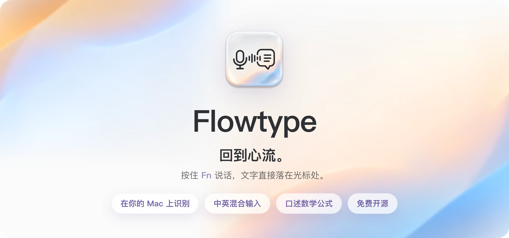
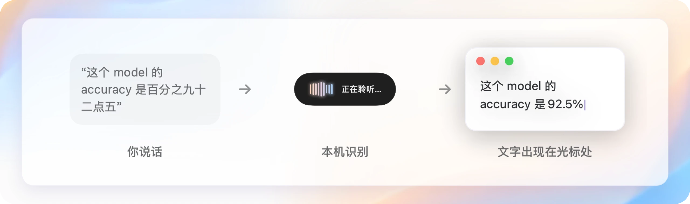
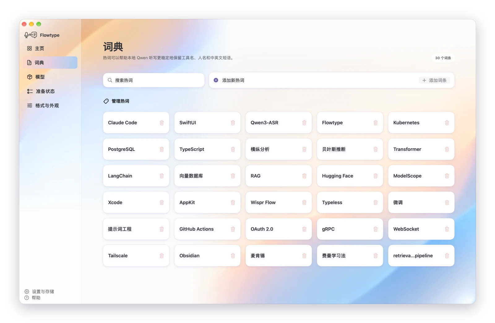
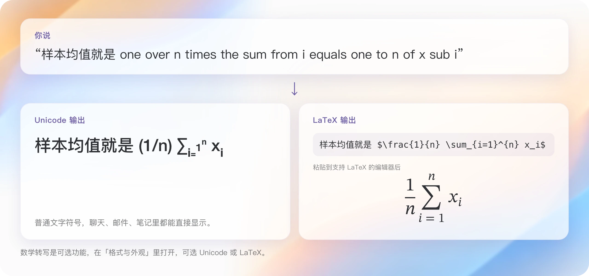
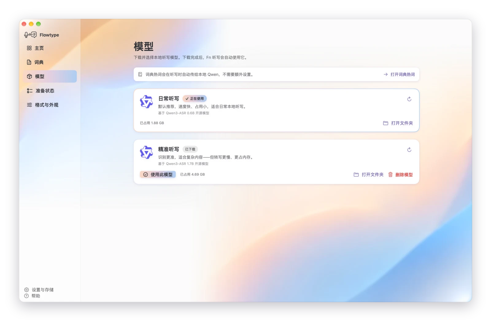

<p align="center">
  
</p>

<p align="center">
  <a href="README.md">English</a> · 简体中文
</p>

<p align="center">
<a href="https://github.com/smgonthebeat/Flowtype/releases/download/v0.1.0-preview.9/Flowtype.dmg">
  
</a>
</p>

<p align="center">
  <a href="https://github.com/smgonthebeat/Flowtype/releases/tag/v0.1.0-preview.9"><code>v0.1.0-preview.9</code></a> ·
  <a href="https://github.com/smgonthebeat/Flowtype/releases/download/v0.1.0-preview.9/Flowtype.dmg.sha256">校验 SHA-256</a> ·
  <a href="#first-launch">首次打开指引</a>
</p>

> [!NOTE]
> 这是 Preview 版本。安装包使用 local development signature，**没有 Apple Developer ID，也未经过 Apple notarization**。macOS 会拦截第一次打开，需要你在「系统设置 → 隐私与安全性」里手动选择「仍要打开」，步骤见[首次打开指引](#first-launch)。

Flowtype 是一款 local-first 的 macOS 听写工具。按住 `Fn` 说话，松开后在这台 Mac 上完成转写，整句话直接出现在你正在用的 App 的光标处。它专门为真实的说话方式而做：中文夹着 English，甚至直接念公式。

<!-- LAUNCH VIDEO: the Flowtype Dawn launch film (57 s), uploaded to GitHub so it plays inline. -->
https://github.com/user-attachments/assets/1422522b-5274-48fd-ae4e-22315114ab29

## 怎么用

<p align="center">
  
</p>

1. 在任意 App 里把光标放到要输入的位置；
2. 按住 `Fn` 说话，屏幕下方出现录音胶囊，晨光波纹跟着你的声音跳动；
3. 松开 `Fn`，Flowtype 在本机转写，整句话一次落到光标处。

不用切换窗口，也不用复制粘贴。

## 说话，比打字快得多

<p align="center">
  
</p>

这些是作者自己每天使用的真实数据，截至 2026-10-12：**21,578 次听写**，累计口述 **63 小时 9 分**，**100.5 万字**。同样的内容如果用键盘打，估计要约 315 小时，Flowtype 估算节省了 **251 小时 37 分**。Flowtype 首先是作者每天在用的工具，然后才成为开源项目。

<sub>打字时间是估算：中文按每分钟 55 字、英文按每分钟 35 词计算，再减去说话时间。中文按字计，英文按词计。</sub>

## 中英混合输入，30+ 种语言

日常说话很少是纯中文或纯英文。Flowtype 用在本机运行的 Qwen3-ASR 识别语音，不锁定语言，由模型自己判断你说的是哪种，支持 30+ 种语言和 22 种中文方言。一句话里随时换语言，比如中文夹着 English，不用切换模式。

产品名、人名、专业词这类要按特定写法出现的词，直接说不一定能写成你想要的样子。把它们按你想要的写法加进**词典**，Flowtype 会在识别时把这些词作为上下文交给本地模型，写法和大小写就更容易照你的来。

<p align="center">
  
</p>

## 说出来，就是公式

打开数学转写后，你可以直接念公式，Flowtype 会在本机把它变成真正的数学符号。输出可以选 **Unicode**（普通文字符号，哪里都能显示）或 **LaTeX**（适合 Markdown、Obsidian 和论文）。

<p align="center">
  
</p>

更多例子。中文句子里的公式部分用英文念，效果最好：

| 你说 | Unicode 输出 | LaTeX 输出（渲染后） |
|---|---|---|
| 回归方程是 y 等于 beta zero 加 beta one x 加 epsilon | 回归方程是 y = β₀ + β₁x + ε | 回归方程是 $y = \beta_0 + \beta_1 x + \epsilon$ |
| x 服从均值为 mu 方差为 sigma squared 的正态分布 | X ∼ N(μ, σ²) | $X \sim N(\mu, \sigma^2)$ |
| 所以置信区间是 x bar 加减 z sub alpha over two 乘以 sigma over root n | 所以置信区间是 x̄ ± z_{α/2}·σ/√n | 所以置信区间是 $\bar{x} \pm z_{\alpha/2} \cdot \frac{\sigma}{\sqrt{n}}$ |
| 我们拒绝 h zero，因为 p value 小于零点零五 | 我们拒绝 H₀，因为 p < 0.05 | 我们拒绝 $H_0$，因为 $p \lt 0.05$ |
| beta one hat 的方差等于 sigma squared 除以 n | Var(β̂₁) = σ²/n | $\mathrm{Var}(\hat{\beta}_1) = \frac{\sigma^2}{n}$ |
| probability of A given B equals probability of B given A times probability of A over probability of B | P(A \| B) = P(B \| A)·P(A)/P(B) | $P(A \mid B) = P(B \mid A) \cdot \frac{P(A)}{P(B)}$ |
| 面积就是 integral from zero to one of f of x dx | 面积就是 ∫₀¹ f(x) dx | 面积就是 $\int_{0}^{1} f(x)\\,dx$ |
| integral from negative infinity to infinity of e to the minus x squared dx equals root pi | ∫_{−∞}^{∞} e^{−x²} dx = √π | $\int_{-\infty}^{\infty} e^{-x^2}\\,dx = \sqrt{\pi}$ |
| partial f partial x | ∂f/∂x | $\frac{\partial f}{\partial x}$ |

<sub>以上输出都由 Flowtype 的本地转换程序实际生成，前提是语音识别本身听对了。数学转写是可选功能，默认关闭，在「格式与外观」里打开。</sub>

## 在你的 Mac 上识别

Flowtype 不是“上传后尽快删除”，而是让日常转写从一开始就不必进入云端 ASR：

- **纯本地转写：** Qwen3-ASR 在 Apple Silicon 本机运行，通过只监听 `127.0.0.1`、带 session token 的本地 helper 调用。模型准备好之后，日常转写不需要上传录音。
- **本地临时录音，转写即删：** 每次听写的临时 WAV 在转写结束后删除。开启 History 时，只为手动重试在本机滚动保留最近最多 3 条录音，清空 History 也会一起清除。
- **历史由你控制：** 转写文本只存在这台 Mac 的 History 里，默认最多 100 条，可以关闭、调整数量或随时清空。
- **备用路径也在本机：** Apple Speech fallback 只在设备支持 on-device recognition 时运行，并强制 `requiresOnDeviceRecognition`。
- **网络边界清楚：** 第一次准备时需要下载约 1.9 GB 的模型，这是明确的网络操作，之后日常转写走本机。

<p align="center">
  
</p>

Wispr Flow、Typeless、千问输入法和豆包输入法等主流语音输入工具，会在其部分或主要转写路径中把语音发送至云端处理。部分产品提供加密传输、即时删除、Privacy Mode 或 zero-retention 设置，这些都是有价值的隐私措施。Flowtype 的区别是避免日常转写的上传步骤，而不是指责其他产品会上传所有键入内容。闪电说等提供可选本地识别路径的产品不属于“只能云端转写”这一类。

完整边界见 [Privacy 与本地数据](docs/PRIVACY.md)，带日期、版本和证据说明的比较见 [本地与云端转写比较](docs/PRIVACY-COMPARISON.md)。

## 还有这些

- **智能格式：** 数字、百分比、日期、题号与小问自动整理，比如「百分之三点五」→ `3.5%`；可选清理「嗯」「呃」等口头填充词。
- **晨光外观：** 默认的 Flowtype Dawn 浅色主题，也可以换成其他主题。
- **中文 / English 界面：** 第一次打开就能选界面语言，菜单、主窗口和设置一起切换；正文有三档文字大小。
- **失败可恢复：** History、最多三条本地重试录音、模型状态和 diagnostics，出问题时能找回内容、定位原因。
- **上手有引导：** 五页图解新手引导，带一页按住 `Fn` 的练习。

<p align="center">
  
</p>

<sub>新手引导里练习按住 <code>Fn</code> 说话。界面截图里的历史记录、热词和统计数字是演示数据。</sub>

## 安装

### 系统要求

- macOS 14 或以上，Apple Silicon Mac；
- Microphone 与 Accessibility 权限；
- 数 GB 可用存储与内存，用于本地模型和 runtime。

### 下载与准备

只从官方 [`v0.1.0-preview.9` Release](https://github.com/smgonthebeat/Flowtype/releases/tag/v0.1.0-preview.9) 下载 `Flowtype.dmg`，打开后按窗口里的箭头把 `Flowtype.app` 拖进 Applications。普通用户不需要安装 Swift，也不需要自己编译。

第一次打开时，五页图解引导会带你选择界面语言、完成准备、练习按住 `Fn` 说话。点击「一键准备 Flowtype」就是确认本次下载：Flowtype 会请求 Microphone 与 Accessibility 权限，自动下载约 1.9 GB 的默认 Qwen3-ASR 0.6B 模型，并实时显示已下载大小、平滑网速、预计剩余时间与准备进度。新下载优先使用 ModelScope，保留 Hugging Face 备用和断点续传。Accessibility 需要你在系统设置里确认，回到 Flowtype 后流程会自动继续。准备完成后，主页会立即沿用已验证的 Ready 状态，不需要再次点击准备。模型权重不在本仓库里，也不在源码压缩包里。

<a id="first-launch"></a>

### 首次打开 Flowtype

这是明确标注的 **unnotarized Preview**。第一次双击时，macOS 会因为无法验证开发者而拦截。这是当前签名状态下的预期行为，不需要关闭系统安全保护。

<table>
  <tr>
    <td width="42%" valign="top">
      <strong>1. 先尝试打开一次</strong><br><br>
      双击 Applications 中的 Flowtype，在提示中先点击「打开」。如果 macOS 仍然阻止启动，关闭该对话框并继续下一步；只有尝试打开过，后面的「仍要打开」按钮才会出现。
    </td>
    <td width="58%" valign="top">
      <strong>2. 在「隐私与安全性」中放行</strong><br><br>
      打开「系统设置 → 隐私与安全性」，向下滚动到「安全性」，找到“已阻止使用 Flowtype”，点击「仍要打开」。按提示验证登录密码或 Touch ID，最后确认「打开」。
    </td>
  </tr>
  <tr>
    <td valign="top">
      
    </td>
    <td valign="top">
      
    </td>
  </tr>
</table>

**3. 对照 Apple 官方步骤。** Apple 当前说明同样要求先尝试打开 App，再进入「系统设置 → 隐私与安全性 → 安全性」选择「打开 / 仍要打开」。按钮通常只在尝试打开后的约一小时内出现；如果没有看到，请再次双击 Flowtype，然后立即返回该页面。

<details>
<summary>查看 Apple 官方指引截图</summary>

<a href="https://support.apple.com/zh-cn/guide/mac-help/mh40616/mac">
  
</a>

*[查看 Apple 官方实时说明](https://support.apple.com/zh-cn/guide/mac-help/mh40616/mac)。截图仅用于帮助定位设置；Apple 页面与 macOS 文案可能随版本变化。*

</details>

只对你确认来自本项目官方 Release 的 Flowtype 执行上述操作。**不要关闭 Gatekeeper，也不要运行任何 quarantine-removal 或 Gatekeeper-disabling 命令。**

## 从源码构建

以下命令面向想审阅或修改源码的 developers，需要 Swift 5.9 或以上：

```bash
swift test
uv run --project Helpers/qwen-asr-helper --frozen pytest
make build
```

`make build` 会在 `.build/Flowtype.app` 生成本地 ad-hoc signed development bundle，它不等同于官方 distribution build。

## 文档

- [安装与源码构建](docs/INSTALL.md)
- [Privacy 与本地数据](docs/PRIVACY.md)
- [本地与云端转写比较](docs/PRIVACY-COMPARISON.md)
- [Architecture](docs/ARCHITECTURE.md)
- [Troubleshooting](docs/TROUBLESHOOTING.md)
- [Changelog](CHANGELOG.md)
- [Contributing](CONTRIBUTING.md)
- [Security Policy](SECURITY.md)

提交 issue 时不要附上真实录音、transcript、credential 或 private diagnostics。

## License

Flowtype software 与 project-provided assets 在项目有权授予的范围内采用 [`GPL-3.0-only`](LICENSE)。Third-party components、assets 与 marks 的例外见 [THIRD_PARTY_NOTICES.md](THIRD_PARTY_NOTICES.md)、[ASSET_PROVENANCE.md](ASSET_PROVENANCE.md) 和 [TRADEMARKS.md](TRADEMARKS.md)。
